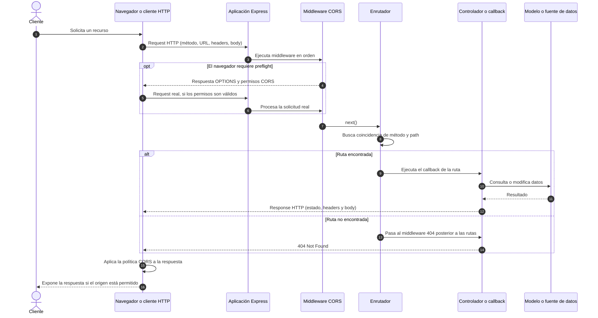
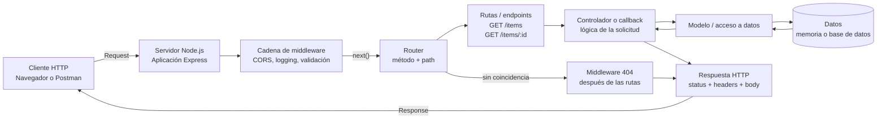
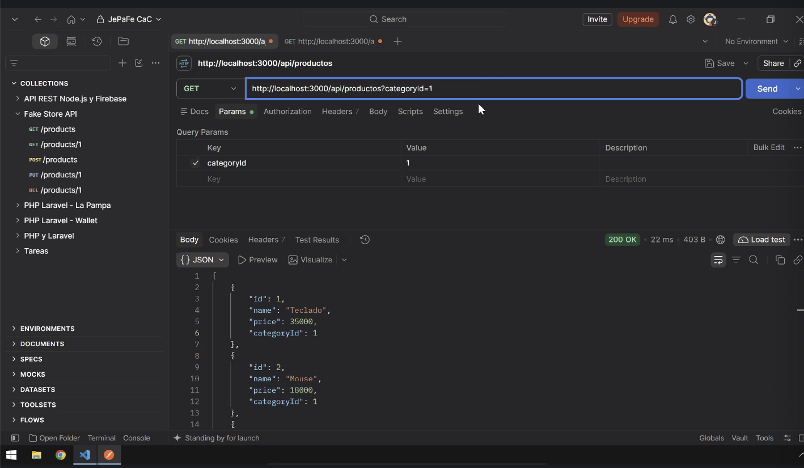

# Clase 11: Request y Response

Apuntes técnicos de la clase sobre el ciclo de una petición HTTP en una API
REST con Node.js y Express. Se cubren el enrutamiento, los métodos HTTP,
middlewares, CORS, respuestas 404, parámetros de ruta y de consulta, y pruebas
con Postman. El material fuente es el [PDF de la clase](./Clase%2011%20-%20REQUEST%20%26%20RESPONSE.pdf).

> **Alcance de este repositorio:** el PDF contiene los temas y ejercicios de la
> clase. El archivo [`index.js`](./index.js) implementa una API de ejemplo con
> datos en memoria, filtros, validación de entrada, creación de productos y
> respuestas de error.

## Contenidos

- [Objetivos](#objetivos)
- [Modelo request-response](#modelo-request-response)
- [Enrutamiento y métodos HTTP](#enrutamiento-y-métodos-http)
- [Diagrama de secuencia](#diagrama-de-secuencia)
- [Diagrama de componentes](#diagrama-de-componentes)
- [Anatomía de una solicitud y una respuesta](#anatomía-de-una-solicitud-y-una-respuesta)
- [Middleware y orden de ejecución](#middleware-y-orden-de-ejecución)
- [CORS](#cors)
- [Rutas parametrizadas](#rutas-parametrizadas)
- [Códigos de estado y manejo de errores](#códigos-de-estado-y-manejo-de-errores)
- [Postman](#postman)
- [Ejemplo del repositorio](#ejemplo-del-repositorio)
- [Puesta en marcha](#puesta-en-marcha)
- [Ejercicio práctico](#ejercicio-práctico)
- [Glosario conceptual](#glosario-conceptual)
- [Recursos](#recursos)

## Objetivos

Al finalizar esta unidad, se espera poder:

1. Definir endpoints que respondan a una combinación de método HTTP y ruta.
2. Explicar cómo circula una solicitud desde el cliente hasta la respuesta del
   servidor.
3. Usar middleware para aplicar lógica transversal y para responder cuando una
   ruta no existe.
4. Comprender qué controla CORS y cómo configurar los orígenes permitidos.
5. Capturar y validar parámetros de ruta (`path params`) y de consulta
   (`query params`).
6. Probar endpoints, encabezados, cuerpos y códigos de estado con Postman.

## Modelo request-response

HTTP es un protocolo de comunicación basado en solicitudes y respuestas. El
cliente inicia una solicitud; el servidor la procesa y devuelve una respuesta.
Una API REST expone recursos mediante endpoints y comunica los resultados
normalmente como JSON.

```text
Cliente                         Servidor
  |                                |
  |--- solicitud HTTP ------------>|
  |                                | método + ruta
  |                                | middleware
  |                                | ruta + lógica
  |<-- respuesta HTTP -------------|
  |    estado + encabezados + body |
```

Una ruta no se identifica solamente por su URL: se resuelve usando, como mínimo,
el método HTTP y el path. Por eso `GET /items/123` y `DELETE /items/123` pueden
representar operaciones diferentes sobre el mismo recurso.

## Enrutamiento y métodos HTTP

El enrutador de Express compara el método y la ruta de la solicitud con las
rutas registradas. Cuando encuentra una coincidencia, ejecuta el callback
correspondiente.

| Método | Uso habitual | Efecto esperado |
| --- | --- | --- |
| `GET` | Consultar uno o varios recursos | Leer datos sin modificarlos |
| `POST` | Crear un recurso o iniciar una operación | Puede producir cambios |
| `PUT` | Reemplazar un recurso existente | Reemplazo completo, según el contrato de la API |
| `PATCH` | Modificar parcialmente un recurso | Actualización parcial |
| `DELETE` | Eliminar un recurso | Quitar el recurso identificado |

Ejemplo: mismo path, intención distinta según el método:

```js
app.get('/items/:id', (req, res) => {
  // Buscar y devolver el item identificado.
});

app.delete('/items/:id', (req, res) => {
  // Eliminar el item identificado.
});
```

En Express, `app.get()`, `app.post()`, `app.put()`, `app.patch()` y
`app.delete()` registran rutas asociadas a esos métodos. `app.use()` registra
middleware, que puede ejecutarse para múltiples métodos y rutas.

### Diagrama de secuencia

El diagrama muestra el flujo habitual de una solicitud desde un navegador hasta
la respuesta. CORS interviene cuando el cliente es un navegador y la solicitud
es de origen cruzado; Postman no aplica la política CORS del navegador.



El ejemplo del repositorio no implementa esta cadena completa: su middleware
global envía una respuesta antes de que Express alcance el enrutador. Ese caso
real se detalla en [Ejemplo del repositorio](#ejemplo-del-repositorio).

### Diagrama de componentes

El siguiente diagrama representa los componentes conceptuales de la aplicación
de la clase. No implica que cada responsabilidad ya esté separada en archivos:
en `index.js`, los datos y la lógica de las rutas están definidos en el mismo
módulo.



| Componente | Responsabilidad |
| --- | --- |
| Cliente HTTP | Construir y enviar la solicitud; interpretar la respuesta. |
| Aplicación Express | Recibir solicitudes HTTP y ejecutar la cadena configurada. |
| Middleware | Ejecutar lógica común antes de las rutas o después de ellas. |
| Router | Buscar una ruta que coincida con el método y el path. |
| Controlador o callback | Validar los datos, coordinar el acceso a datos y responder. |
| Modelo / fuente de datos | Consultar o modificar los datos del dominio. |
| Middleware 404 | Responder a las solicitudes que no coincidieron con ninguna ruta. |

## Anatomía de una solicitud y una respuesta

### Solicitud HTTP

Una solicitud puede incluir:

| Parte | Ejemplo | Uso |
| --- | --- | --- |
| Método | `GET` | Indica la operación solicitada. |
| Path | `/api/productos/2` | Identifica el endpoint o recurso. |
| Path params | `2` en `/productos/:id` | Identifica un recurso dentro del path. |
| Query string | `?categoria=tecnologia` | Agrega filtros u opciones a la URL. |
| Headers | `Content-Type: application/json` | Transporta metadatos, autenticación o formato. |
| Body | `{"nombre":"Teclado"}` | Transporta datos, normalmente en `POST`, `PUT` o `PATCH`. |

Ejemplo completo:

```http
GET /api/productos/2?incluirCategoria=true HTTP/1.1
Host: localhost:3001
Accept: application/json
```

### Respuesta HTTP

Una respuesta se compone de:

| Parte | Ejemplo | Función |
| --- | --- | --- |
| Código de estado | `200 OK` | Comunica el resultado de la operación. |
| Headers | `Content-Type: application/json` | Describen metadatos de la respuesta. |
| Body | `{"id":2,"nombre":"Mouse"}` | Contiene el resultado, si corresponde. |

En Express se pueden definir el estado y el cuerpo en una misma respuesta:

```js
res.status(200).json({ mensaje: 'Solicitud procesada' });
res.status(404).send('Recurso no encontrado');
```

`res.json()` serializa el valor como JSON y establece el tipo de contenido
correspondiente. `res.send()` envía el contenido indicado. Una solicitud debe
terminar con una respuesta o continuar mediante `next()`; responder dos veces
para la misma solicitud provoca un error.

## Middleware y orden de ejecución

Un middleware de Express es una función que recibe `(req, res, next)`. Puede
inspeccionar o modificar la solicitud y la respuesta, ejecutar una tarea común,
finalizar la respuesta o transferir el control al siguiente middleware.

```js
app.use((req, res, next) => {
  console.log(`${req.method} ${req.url}`);
  next();
});
```

- `req` (`Request`) contiene los datos de la solicitud.
- `res` (`Response`) permite construir y enviar la respuesta.
- `next()` cede el control al siguiente middleware o a la ruta coincidente.
- Si el middleware envía una respuesta, la solicitud queda finalizada y no
  alcanza las rutas siguientes.
- Si un middleware no envía una respuesta ni llama a `next()`, la solicitud
  queda pendiente.

El orden en que se registran los middleware y las rutas es significativo:

1. Middleware global que deba ejecutarse en todas las solicitudes, como CORS o
   logging.
2. Rutas de la aplicación.
3. Middleware 404 para solicitudes que no coincidieron con una ruta.
4. Middleware de errores, si se configura.

El middleware 404 es un middleware normal de tres argumentos y debe ubicarse
después de las rutas. El manejador de errores de Express es distinto: recibe
cuatro argumentos (`err, req, res, next`).

## CORS

CORS (*Cross-Origin Resource Sharing*) es un mecanismo basado en encabezados
HTTP que permite a un servidor indicar qué orígenes pueden leer sus respuestas
desde un navegador. Un origen se compone de **protocolo, host y puerto**; por
ejemplo, `http://localhost:3000` y `http://localhost:3001` son orígenes
diferentes.

La política CORS la aplica el navegador a solicitudes realizadas por código
web, por ejemplo mediante `fetch` o `XMLHttpRequest`. No es autenticación ni
reemplaza controles de autorización del servidor. Herramientas como Postman
pueden enviar solicitudes de distintos orígenes sin bloquearlas por CORS.

### Solicitud simple y preflight

- En una solicitud simple, el navegador envía la solicitud y luego comprueba
  los encabezados CORS de la respuesta antes de entregar el contenido al
  JavaScript de la página.
- Para algunas solicitudes no simples, el navegador envía primero una solicitud
  `OPTIONS` de preflight para preguntar si el método y los encabezados están
  permitidos.
- El servidor debe responder con encabezados compatibles con el origen,
  método y encabezados solicitados. Si no lo hace, el navegador impide que el
  código cliente lea la respuesta.

### Configuración con la librería `cors`

La librería `cors` permite declarar la política como middleware de Express:

```js
import cors from 'cors';

app.use(cors({
  origin: ['https://app.example.com', 'https://admin.example.com'],
  methods: ['GET', 'POST', 'PUT', 'PATCH', 'DELETE'],
  allowedHeaders: ['Content-Type', 'Authorization'],
  credentials: true,
}));
```

Instalación:

```bash
npm install cors
```

`app.use(cors())` es una configuración amplia, adecuada solo cuando la API
realmente debe ser legible desde cualquier origen. En producción conviene
restringir los orígenes y permisos al mínimo necesario. Cuando se habilitan
credenciales, el servidor no debe autorizar el origen comodín `*`; debe
responder con un origen explícito compatible con la política.

También es posible establecer encabezados manualmente, pero hay que tratar
correctamente las solicitudes `OPTIONS` y mantener coherentes los encabezados
permitidos. Para una configuración habitual, el middleware de la librería
reduce el trabajo manual.

## Rutas parametrizadas

### Path params

Los parámetros de ruta son segmentos variables que forman parte del path y
normalmente identifican un recurso:

```js
app.get('/api/productos/:id', (req, res) => {
  const id = Number(req.params.id);
  // Validar id, buscar el producto y responder.
});
```

Para una solicitud a `/api/productos/42`, Express asigna `"42"` a
`req.params.id`. Los valores recibidos desde una URL son texto: hay que
validarlos y convertirlos antes de usarlos como números u otros tipos.

### Query params

Los parámetros de consulta son pares clave-valor que aparecen después de `?`.
Se usan normalmente para filtros, paginación, ordenamiento u opciones:

```text
/api/productos?categoria=tecnologia&precioMaximo=100
```

```js
app.get('/api/productos', (req, res) => {
  const { categoria, precioMaximo } = req.query;
  // Validar los filtros y aplicarlos a la consulta.
});
```

En el ejemplo, `req.query.categoria` vale `"tecnologia"` y
`req.query.precioMaximo` vale `"100"`. También son valores de entrada y deben
validarse. Los parámetros pueden no estar presentes, repetirse o tener una
forma inesperada.

### Comparación

| Criterio | Path param | Query param |
| --- | --- | --- |
| Ubicación | En el path: `/productos/:id` | Después de `?`: `/productos?categoria=ropa` |
| Acceso en Express | `req.params.id` | `req.query.categoria` |
| Uso típico | Identificar un recurso requerido | Filtrar o modificar la consulta |
| Ejemplo | `GET /productos/42` | `GET /productos?categoria=hogar` |
| Carácter habitual | Parte de la identidad del recurso | Opcional, combinable y normalmente no identificador |

Se pueden combinar: `GET /api/productos/42?incluirCategoria=true` identifica el
producto `42` y agrega una opción de consulta.

## Códigos de estado y manejo de errores

El código de estado forma parte de la respuesta HTTP y comunica el resultado
sin depender únicamente del texto del body.

| Estado | Nombre | Uso habitual |
| --- | --- | --- |
| `200` | OK | Solicitud procesada correctamente, normalmente con respuesta. |
| `201` | Created | Se creó un recurso correctamente. |
| `204` | No Content | La operación fue correcta y no devuelve body. |
| `400` | Bad Request | La solicitud o alguno de sus datos no es válido. |
| `401` | Unauthorized | Falta autenticación válida. |
| `403` | Forbidden | El cliente está identificado, pero no tiene permiso. |
| `404` | Not Found | No existe una ruta o recurso solicitado. |
| `422` | Unprocessable Content | El body tiene formato JSON válido, pero no cumple las validaciones del recurso. |
| `500` | Internal Server Error | Ocurrió un error inesperado en el servidor. |

Una ruta dinámica puede devolver `404` cuando no encuentra el recurso aunque la
ruta sí exista. Un middleware 404 posterior a todas las rutas, en cambio,
resuelve paths que no coinciden con ningún endpoint:

```js
app.get('/api/productos/:id', (req, res) => {
  const id = Number(req.params.id);
  const producto = productos.find((item) => item.id === id);

  if (!producto) {
    return res.status(404).json({ error: 'Producto no encontrado' });
  }

  return res.status(200).json(producto);
});

app.use((req, res) => {
  res.status(404).json({ error: 'Ruta no encontrada' });
});
```

El middleware 404 debe declararse después de las rutas. No conviene responder
`200` ante una operación fallida: el status debe reflejar el resultado, y el
body puede agregar un mensaje útil y consistente.

## Postman

Postman es un cliente HTTP con interfaz gráfica. Permite probar una API sin
necesitar una aplicación frontend y observar el estado, los encabezados y el
cuerpo de cada respuesta.

Flujo básico:

1. Crear una solicitud y seleccionar el método HTTP.
2. Ingresar la URL, por ejemplo `http://localhost:3001/api/productos/2`.
3. Agregar query params en la sección **Params**, headers en **Headers** y, si
   corresponde, un body en **Body**.
4. Enviar la solicitud con **Send**.
5. Inspeccionar status, headers, body y duración de la respuesta.
6. Guardar ejemplos y organizar solicitudes en colecciones para repetir las
   pruebas.

Pruebas sugeridas para esta clase:

| Caso | Solicitud | Verificación |
| --- | --- | --- |
| Listar productos | `GET /api/productos` | Estado y lista JSON. |
| Buscar por ID existente | `GET /api/productos/2` | Producto correspondiente al ID. |
| Buscar por ID inexistente | `GET /api/productos/999` | `404` y mensaje claro. |
| Filtrar por query param | `GET /api/productos?categoryId=1` | Solo resultados de la categoría 1. |
| Ruta inexistente | `GET /api/no-existe` | `404` estandarizado. |
| Crear producto | `POST /api/productos` con JSON válido | `200 OK` y producto agregado durante la ejecución del servidor. |
| Validar body | `POST /api/productos` con campos faltantes o inválidos | `422` y un objeto JSON con el error. |
| CORS en navegador | Solicitud desde un frontend con otro origen | Encabezados CORS válidos; Postman por sí solo no prueba la política del navegador. |

Postman también permite automatizar verificaciones sobre el código de estado y
el contenido de la respuesta mediante scripts de prueba.

### Captura de Postman

La siguiente captura muestra una solicitud `GET` a
`http://localhost:3000/api/productos?categoryId=1`. En **Params** está activo
el query param `categoryId=1`; Postman muestra una respuesta `200 OK` y un
arreglo JSON de productos con los campos `id`, `name`, `price` y `categoryId`.



La captura es una referencia de una ejecución en el puerto `3000`. El servidor
de este ejemplo escucha en el puerto `3001`; la API implementada usa el mismo
nombre de parámetro (`categoryId`) y el mismo formato de datos de la captura.

## Ejemplo del repositorio

El archivo [`index.js`](./index.js) define una aplicación Express que escucha
en el puerto `3001` y declara arreglos locales para categorías y productos. No
hay conexión a una base de datos: los datos viven en memoria y se reinician al
reiniciar el proceso.

### Middleware global y datos

Antes de las rutas, un middleware registra el método y la URL (`req.method` y
`req.url`) y llama a `next()` para continuar. Luego `express.json()` analiza
los cuerpos de las solicitudes JSON y deja los datos disponibles en `req.body`.
El ejemplo utiliza arreglos en memoria: los productos creados con `POST` se
mantienen mientras el proceso Node.js siga activo y se pierden al reiniciarlo.

### Endpoints implementados

| Método | Ruta | Función | Respuestas principales |
| --- | --- | --- | --- |
| `GET` | `/` | Devuelve un mensaje para comprobar que el servidor funciona. | `200 OK` |
| `GET` | `/api/productos` | Devuelve todos los productos; acepta `?categoryId=<id>` para filtrar. | `200 OK`, `400 Bad Request` si el filtro no es un entero positivo. |
| `GET` | `/api/categorias` | Devuelve la lista de categorías. | `200 OK` |
| `POST` | `/api/productos` | Valida el body, agrega un producto en memoria y devuelve `OK`. | `200 OK`, `422 Unprocessable Content` si los datos son inválidos o falta una categoría válida. |
| `GET` | `/api/productos/:id` | Busca un producto por su identificador. | `200 OK`, `400 Bad Request` si el ID no es numérico, `404 Not Found` si no existe. |
| Cualquier método | Ruta no definida | Devuelve un error JSON de ruta inexistente. | `404 Not Found` |

El orden es relevante: primero se registra logging y el parser JSON, luego las
rutas y finalmente el middleware 404. De ese modo, el 404 solo responde cuando
ningún endpoint anterior terminó la solicitud.

### Consultar y filtrar productos

Sin filtro:

```http
GET http://localhost:3001/api/productos
```

Filtrar por categoría:

```http
GET http://localhost:3001/api/productos?categoryId=1
```

`categoryId` es un query param que Express expone como `req.query.categoryId`.
El servidor verifica que el valor sea un entero positivo. Si es válido, devuelve
los productos de esa categoría; un identificador válido sin productos asociados
devuelve una lista vacía. Si el valor tiene un formato inválido, responde `400`.

Para consultar un único producto se usa el path param `id`:

```http
GET http://localhost:3001/api/productos/2
```

Express entrega `"2"` en `req.params.id`; el callback lo convierte a número y
exige un entero positivo. Devuelve `400` si el formato no es válido, `404` si
no hay coincidencia y el producto JSON si existe.

### Crear un producto

`POST /api/productos` espera un cuerpo JSON con los campos `name`, `price` y
`categoryId`. El middleware `express.json()` es necesario para leerlo desde
`req.body`.

```http
POST http://localhost:3001/api/productos
Content-Type: application/json
```

```json
{
  "name": "Auriculares",
  "price": 25000,
  "categoryId": 1
}
```

La ruta comprueba que el nombre no esté vacío, que el precio sea un número
finito no negativo, que `categoryId` sea un entero y que la categoría exista.
Si falla alguna validación, devuelve `422` con un objeto `error`; si es válido,
asigna el siguiente ID, agrega el producto al arreglo y responde `OK`. Al estar
guardado solo en memoria, el producto no persiste después de reiniciar el
servidor.

### Parámetros de la solicitud: `req`

Express entrega el objeto de solicitud `req` al callback de cada ruta. En este
archivo se usan varias propiedades:

| Propiedad | Ejemplo del archivo | De dónde sale |
| --- | --- | --- |
| `req.params.id` | En `GET /api/productos/:id` | Del segmento dinámico del path; por ejemplo, `/api/productos/2` produce el valor de texto `"2"`. |
| `req.query.categoryId` | En `GET /api/productos` | De la query string; por ejemplo, `/api/productos?categoryId=1`. |
| `req.body` | En `POST /api/productos` | Del cuerpo JSON, procesado previamente por `express.json()`. |
| `req.method` y `req.url` | En el middleware de logging | Del método HTTP y la URL solicitados. |

Los valores de `req.params` y `req.query` llegan como texto y deben validarse
antes de usarse. `POST` recibe el body como objeto JSON; si se envían campos
ausentes o valores inválidos, la ruta responde `422`.

### Respuestas: `res`

`res` es el objeto de respuesta de Express: permite construir y finalizar la
respuesta HTTP. El archivo usa `res.send()`, `res.json()` y
`res.status(...).json(...)`:

| Expresión | Significado |
| --- | --- |
| `res.send(texto)` | Envía una respuesta con texto y, si no se fija otro estado, normalmente `200 OK`. El `POST` devuelve `OK` después de agregar el producto. |
| `res.json(valor)` | Serializa y envía el valor como JSON; si no se fija otro estado, normalmente `200 OK`. |
| `res.status(400).json(...)` | Indica que un parámetro de la solicitud tiene un formato inválido. |
| `res.status(404).json(...)` | Indica que el producto o la ruta solicitada no existe. |
| `res.status(422).json(...)` | Indica que el body del producto no cumple las validaciones requeridas. |

El `400 Bad Request` se usa en el ejemplo para un `categoryId` o `id` con
formato inválido. El `404 Not Found` se devuelve cuando un ID numérico no
corresponde a un producto, o cuando la ruta no está definida. El `422
Unprocessable Content` se devuelve cuando el JSON está bien formado, pero faltan
datos requeridos, tienen un tipo incorrecto o hacen referencia a una categoría
inexistente.

### Otros detalles relevantes del código

- Los datos usan los campos `id`, `name`, `price` y `categoryId`, como en la
  captura de Postman.
- Los productos y categorías viven en arreglos en memoria, no en una base de
  datos.
- `express.json()` debe ejecutarse antes de `POST /api/productos` para que
  `req.body` contenga el JSON enviado por el cliente.
- El ejemplo de servidor nativo con `node:http` está comentado; no se ejecuta.
- Este ejemplo no configura CORS; para consumirlo desde un navegador en otro
  origen, hace falta agregar esa política. Postman no bloquea solicitudes por
  CORS.

## Puesta en marcha

El directorio contiene `index.js`, pero no incluye un `package.json` ni declara
sus dependencias. Para probar la aplicación desde este directorio, se puede
crear la configuración mínima e instalar Express:

```bash
npm init -y
npm pkg set type=module
npm install express
node index.js
```

La aplicación escucha en `http://localhost:3001`. El middleware de logging
muestra cada método y URL en la consola y llama a `next()`, por lo que el
enrutador procesa la solicitud. Las rutas de productos y categorías devuelven
respuestas JSON; las rutas no definidas reciben un `404`.

Para incorporar el middleware CORS opcional mostrado en esta guía:

```bash
npm install cors
```

## Ejercicio práctico

La misión de la clase consiste en configurar cuatro rutas en el punto de entrada
de la aplicación y validar su comportamiento con Postman. El ejercicio pide:

1. Habilitar solicitudes entre orígenes mediante CORS.
2. Agregar una respuesta `404` para rutas no definidas.
3. Crear rutas con path params, por ejemplo para consultar un producto o usuario
   por ID.
4. Crear rutas que lean query params para filtrar por categoría o precio.
5. Enviar solicitudes desde Postman y comprobar los parámetros, el body y el
   código de estado devuelto.

Una lista de verificación técnica:

- [ ] El middleware CORS se registra antes de las rutas y usa los orígenes
  necesarios, no más.
- [ ] Cada endpoint define con claridad su método y path.
- [ ] Los parámetros de ruta y consulta se validan antes de usarse.
- [ ] La respuesta usa un código de estado coherente y un formato consistente.
- [ ] Cada solicitud termina con una respuesta o continúa con `next()`.
- [ ] El middleware 404 se ubica después de todas las rutas.
- [ ] Se prueban casos válidos, IDs inexistentes, parámetros inválidos y rutas
  no definidas.
- [ ] Se verifica CORS desde un navegador, además de probar el endpoint con
  Postman.

## Glosario conceptual

| Término | Definición |
| --- | --- |
| API | Interfaz que define cómo otros programas solicitan operaciones o datos a un sistema. |
| API REST | API que organiza la interacción alrededor de recursos y usa convenciones HTTP. |
| Cliente | Programa que inicia una solicitud, como un navegador, Postman o una aplicación frontend. |
| Servidor | Programa que recibe solicitudes, ejecuta lógica y devuelve respuestas. |
| Request | Solicitud HTTP iniciada por el cliente. |
| Response | Respuesta HTTP emitida por el servidor. |
| Endpoint | Combinación de método HTTP y path que identifica una operación expuesta por la API. |
| Ruta / route | Regla registrada en el servidor que asocia método y path con un callback. |
| Middleware | Función de Express que participa en la cadena de procesamiento de una solicitud. |
| `next()` | Función que transfiere el control al siguiente middleware o ruta. |
| Path param | Valor dinámico dentro del path, accesible mediante `req.params`. |
| Query param | Valor de la query string, accesible mediante `req.query`. |
| Header | Campo de metadatos de una solicitud o respuesta HTTP. |
| Body | Contenido de datos de una solicitud o respuesta. |
| CORS | Política de intercambio de recursos entre orígenes, aplicada por navegadores mediante encabezados HTTP. |
| Preflight | Solicitud `OPTIONS` que el navegador puede enviar antes de una solicitud CORS no simple. |
| Código de estado | Número HTTP que resume el resultado de una solicitud. |
| 404 handler | Middleware posterior a las rutas que responde cuando ninguna ruta coincide. |
| Postman | Cliente HTTP para enviar solicitudes y revisar o automatizar pruebas de API. |

## Recursos

- [Documentación oficial de Express](https://expressjs.com/)
- [Postman Learning Center](https://learning.postman.com/)
- [MDN: Cross-Origin Resource Sharing (CORS)](https://developer.mozilla.org/docs/Web/HTTP/CORS)
- [MDN: Métodos de petición HTTP](https://developer.mozilla.org/docs/Web/HTTP/Methods)
- [MDN: Códigos de estado HTTP](https://developer.mozilla.org/docs/Web/HTTP/Status)